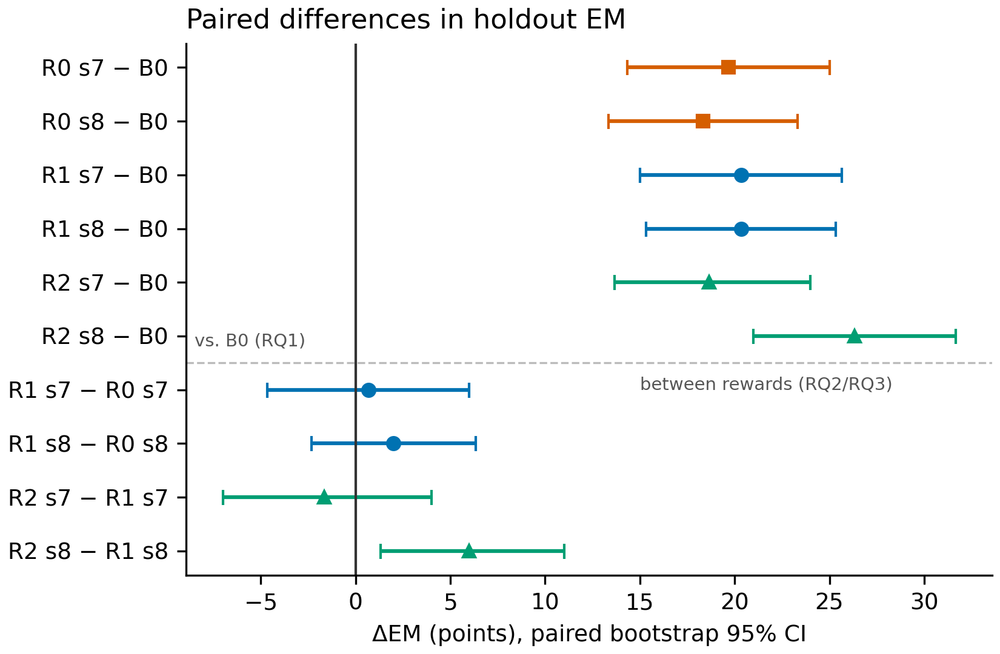
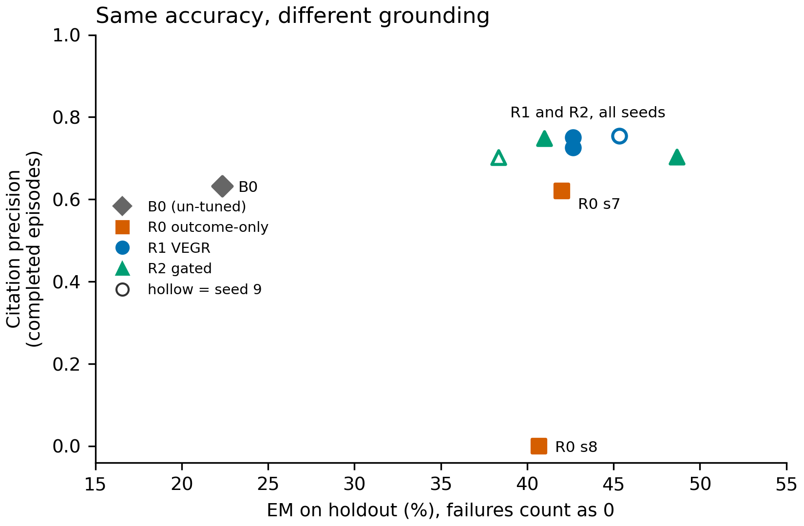
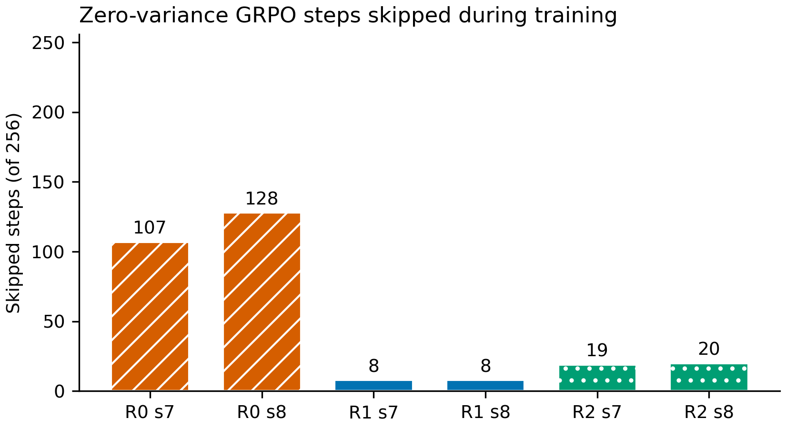
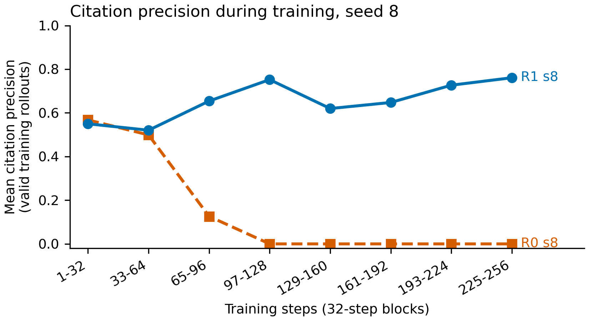
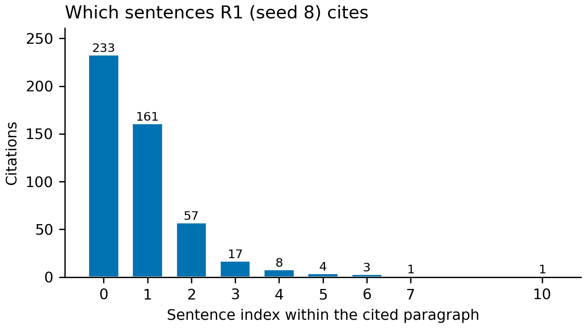
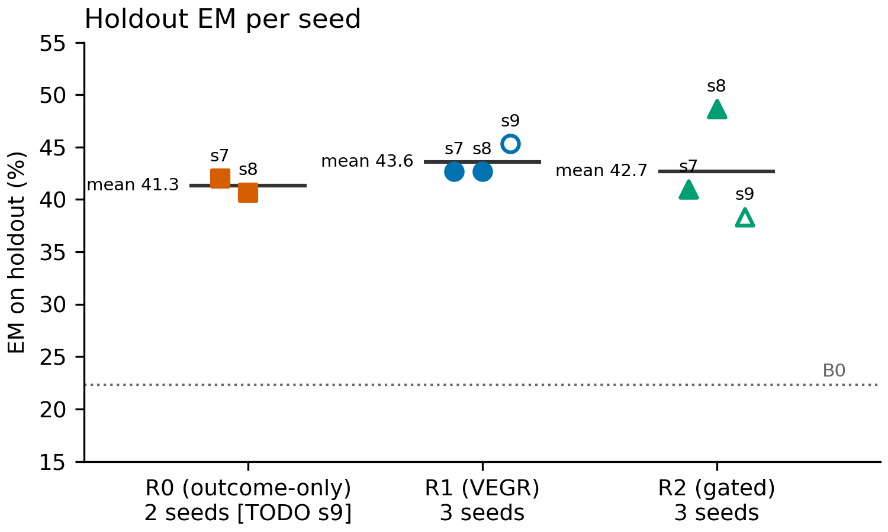
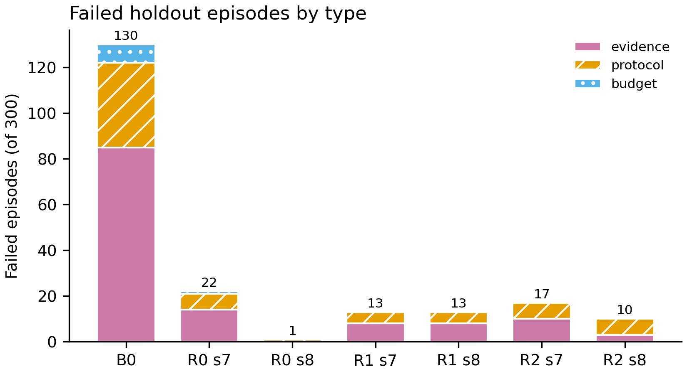

# Chapter 4 — Results and Discussion

> **DRAFT — not submission-ready.** Status as of 2026-10-11. Every number comes from `docs/thesis/writer-brief.md` §4 or from `results/2026-10-10-batch/*/episodes.jsonl`. Results from the fixes batch (R0 seed 9, R3, R4, R0-dyn), grounded EM, and the seed-9 confidence intervals are **pending** (expected ~12:30 WIB 2026-10-12, in `logs/2026-10-11-fixes-batch.md`). They are marked `[TODO]`. Citations marked † still need venue verification (see Chapter 2).

This chapter reports the results in the order of the research questions:

- **4.1** gives the experimental setup.
- **4.2** describes the un-tuned baseline.
- **4.3 to 4.6** answer RQ1, RQ2 and RQ3, with a diagnosis of training dynamics in between (4.5).
- **4.7** shows example traces.
- **4.8** discusses the findings and threats to validity.

Throughout, **EM (all)** is the headline accuracy number: invalid episodes count as wrong, so the denominator is always 300. Quality metrics (F1, coverage, precision, recall, searches) are averaged over **completed** episodes only (Section 3.7).

## 4.1 Experimental setup

| Setting | Value |
|---|---|
| Model | Qwen2.5-7B-Instruct + LoRA (r = 16, α = 32) |
| Training data per run | 256 HotpotQA training questions (seed-dependent sample), 1 epoch |
| Group size / learning rate | G = 8 / 2 × 10⁻⁵ |
| Search budget / top-k | 3 searches / 3 documents |
| Evaluation | 300-question frozen holdout, greedy decoding, no retries |
| Seeds | 7, 8, 9 |
| Hardware | 1 × NVIDIA L40S 48 GB (RunPod, ~$1.10/h) |
| Time and cost per run | ≈ 2.05 h ≈ $2.25 (training + holdout evaluation) |
| Total GPU hours and cost | [TODO: final cost table after the fixes batch] |

## 4.2 Baseline (B0)

The un-tuned model reaches **22.3% EM** on the holdout. Its main problem is not wrong answers but invalid episodes: only **170 of 300** episodes complete. The 130 failures break down into 85 evidence failures, 37 protocol failures, and 8 budget failures. Most evidence failures are invented or unretrievable citations, meaning the model cites a title or sentence it never retrieved.

When the model does complete an episode, it is reasonably capable. EM over completed episodes is 39.4%, citation precision 0.633, and retrieval recall 0.829 (Table 4.1). This already suggests that much of what training can gain lies in following the protocol, which Section 4.3 confirms.

## 4.3 RQ1: Does GRPO improve the agent over the un-tuned model?

**Table 4.1.** Holdout results. EM (all) counts failures as 0; other columns are means over completed episodes.

| Run | Seed | EM (all) | Completed /300 | F1 | Evid. cov. | Cit. prec. | Retr. recall | Searches |
|---|---|---|---|---|---|---|---|---|
| B0 | – | 22.3% | 170 | 0.501 | 0.472 | 0.633 | 0.829 | 1.92 |
| R0 | 7 | 42.0% | 278 | 0.576 | 0.438 | 0.621 | 0.829 | 3.00 |
| R0 | 8 | 40.7% | 299 | 0.530 | 0.000 | 0.000 | 0.710 | 1.01 |
| R0 | 9 | [TODO] | | | | | | |
| R1 (VEGR) | 7 | 42.7% | 287 | 0.593 | 0.473 | 0.751 | 0.851 | 2.30 |
| R1 (VEGR) | 8 | 42.7% | 287 | 0.574 | 0.513 | 0.726 | 0.836 | 2.15 |
| R1 (VEGR) | 9 | 45.3% | 293 | 0.598 | 0.333 | 0.754 | 0.837 | 1.91 |
| R2 (gated) | 7 | 41.0% | 283 | 0.577 | 0.539 | 0.748 | 0.891 | 2.21 |
| R2 (gated) | 8 | 48.7% | 290 | 0.625 | 0.440 | 0.703 | 0.879 | 2.00 |
| R2 (gated) | 9 | 38.3% | 286 | 0.552 | 0.471 | 0.702 | 0.855 | 2.16 |

**Table 4.2.** Paired bootstrap on EM (10,000 resamples, 95% CI).

| Comparison | ΔEM (points) | 95% CI |
|---|---|---|
| R0 s7 − B0 | +19.7 | [+14.3, +25.0] |
| R0 s8 − B0 | +18.3 | [+13.3, +23.3] |
| R1 s7 − B0 | +20.3 | [+15.0, +25.7] |
| R1 s8 − B0 | +20.3 | [+15.3, +25.3] |
| R2 s7 − B0 | +18.7 | [+13.7, +24.0] |
| R2 s8 − B0 | +26.3 | [+21.0, +31.7] |
| Seed-9 comparisons | [TODO] | [TODO] |

All intervals were recomputed from the per-question episode files with `scripts/make_thesis_figures.py` (10,000 resamples, fixed RNG seed 0). Compared with the earlier ad-hoc computation, endpoints differ by at most 0.3 points, which is resampling noise. Figure 4.5 shows the same intervals, together with the between-reward comparisons.



**Figure 4.5.** Paired bootstrap differences in holdout EM, with 95% CIs over the 300 holdout questions.

- **Above the dashed line:** each trained run against B0 (RQ1). Every interval lies far to the right of zero.
- **Below the dashed line:** comparisons between rewards on the same seed (RQ2/RQ3). Three of the four intervals cross zero. The exception, R2 s8 − R1 s8, does not replicate on other seeds (Section 4.6).

**Answer to RQ1: yes.** Every trained run with a computed CI beats B0 by **+18.3 to +26.3 EM points**, and every confidence interval excludes zero. The seed-9 runs (R1 45.3%, R2 38.3%) are also well above B0's 22.3%, but their CIs are not computed yet.

**Where the gain comes from.** Most of the improvement comes from learning the protocol:

- B0 loses 130 of 300 episodes to failures, while every trained run in Table 4.1 loses at most 22.
- Measured over completed episodes only, accuracy moves much less: from 39.4% (B0) to 44.6% (R1 seed 7).

So GRPO mostly teaches the model to produce valid, verifiable actions, and only modestly improves its reasoning on questions it could already complete. The training logs of R1 seed 7 show this directly. The invalid-rollout rate falls from 46% to 29%, 13%, 13% and 7% over the first five 32-step blocks, while average reward rises from 0.97 to 2.81.

**Validation split (supporting evidence only).** On the validation split, R1 seed 7 reaches 57.0% EM against B0's 29.3% (+27.7 points, 95% CI [+21.7, +33.7]). The validation questions appear easier than the holdout, so this number is not used for any claim. It only shows that the gain is not specific to the holdout.

## 4.4 RQ2: Outcome-only reward vs. VEGR

**Accuracy is the same.** Comparing the two rewards seed by seed:

- R1 − R0 is +0.7 points on seed 7 (CI [−4.7, +6.0]) and +2.0 on seed 8 (CI [−2.3, +6.3]).
- Both confidence intervals include zero, so **no accuracy difference can be claimed** between the outcome-only reward and VEGR.
- Mean EM is 41.3% for R0 (2 seeds so far) and 43.6% for R1 (3 seeds). [TODO: update the R0 mean and CIs with seed 9.]

**Grounding is very different.** Although EM is similar, the outcome-only policies do not behave alike. Each seed of R0 drifted into a *different* shortcut, while R1 behaved consistently across seeds.

**R0 seed 8: the citation shortcut.** The policy learned to search once and answer **without any citations** (for example `ANSWER[YG Entertainment]`; see Section 4.7).

- Its holdout citation precision and evidence coverage are both **0.000**, and it averages 1.01 searches per episode.
- All 122 of its correct answers come with no citations.
- This exploits the known loophole in the environment (Section 3.3): an answer with no citations is valid, and the outcome-only reward gives it full credit.
- The training logs show the behaviour developing. Citation precision was 0.13 during steps 65–96 and **0.00 from step 97 on**, while searches per episode fell from 1.3 to 1.0.

**R0 seed 7: duplicate-search spam.** This policy did not drop citations. Instead, it always used all 3 searches (mean 3.00), and **229 of its 278** completed episodes repeat a query. By comparison, B0 repeated a query in 32 episodes, R1 seed 7 in 14, and R1 seed 8 in 7.

**R1 (VEGR) is stable.** Across all three seeds:

- EM stays between 42.7% and 45.3%.
- Citation precision stays between 0.726 and 0.754.
- Searches per episode stay between 1.91 and 2.30.

Neither shortcut appeared.

Figure 4.3 puts both dimensions together. Every trained run sits in the same accuracy band, roughly 38–49% EM. Along the grounding axis, R0 seed 8 lies far from all the others, at citation precision 0.



**Figure 4.3.** Holdout EM (all episodes, failures counted as 0) against citation precision (completed episodes), one point per run.

- Shape and colour encode the reward. Hollow markers are seed-9 runs, whose values come from the run logs.
- R1 and R2 cluster at precision 0.70–0.75. R0 seed 7 sits slightly lower, at 0.62. R0 seed 8 reaches the same EM with precision 0.

**Answer to RQ2 (so far).** VEGR matches the accuracy of outcome-only reward and avoids its shortcuts on the seeds run so far. The outcome-only reward can be satisfied without evidence, and which shortcut the policy finds depends on the seed. The finding fits reward hacking theory (Skalse et al., 2022): the outcome-only reward is a proxy that does not include grounding, and on two of two seeds the policy found a way to satisfy the proxy that the intended objective would reject.

Two caveats limit how strong this claim is:

- R0 seed 9 will show whether a shortcut appears a third time. [TODO]
- **Grounded EM** (EM = 1, at least one citation, every citation gold) will quantify the grounding gap in a single number. R0 seed 8's grounded EM is 0 by construction. Because R1's citation precision is only about 0.75, R1's grounded EM is also expected to be well below its EM. [TODO: grounded EM for all runs.]

## 4.5 Diagnosis: why outcome-only reward is unstable

**Zero-variance groups.** GRPO learns nothing from a group in which all 8 rollouts receive the same reward (Section 3.6), and such steps are skipped. Under the outcome-only reward this happens often, because the reward is binary and many questions are either always solved or never solved within a group.

**Table 4.3.** Skipped (zero-variance) training steps out of 256.

| Run | Skipped steps |
|---|---|
| R0 seed 7 | 107 |
| R0 seed 8 | 128 |
| R1 seed 7 | 8 |
| R1 seed 8 | 8 |
| R2 seed 7 | 19 |
| R2 seed 8 | 20 |
| Seed-9 runs | [TODO: metrics.jsonl not yet downloaded from the pod] |

R0 therefore learns from only about half of its questions, and each of those gives only a coarse right-or-wrong signal. VEGR's continuous terms (F1, coverage, precision, recall, penalties) almost always separate the 8 rollouts, so nearly every step produces a gradient.

Our interpretation, which these data support but do not prove, is that with so few informative updates, whatever habit emerges early in R0 training gets reinforced and locked in. That would explain why the failure mode differs between seeds. The R0-dyn run tests this directly (Section 4.6).



**Figure 4.1.** Number of GRPO training steps skipped because all 8 rollouts in the group received the same reward, out of 256 steps per run. Outcome-only runs (R0, hatched) skip 107–128 steps; VEGR (R1) skips 8 and gated VEGR (R2, dotted) skips 19–20. Source: `metrics.jsonl` of each run; values in `docs/thesis/figures/figures_data.json`.

The training curve for seed 8 (Figure 4.2) shows when the R0 shortcut appeared. Over the first 64 steps, the two rewards produce similar citation precision during training (R0 0.568 and 0.499; R1 0.550 and 0.520). R0 then falls to 0.126 in steps 65–96 and stays at 0.000 for every block from step 97 on, while R1 rises to between 0.62 and 0.76.



**Figure 4.2.** Mean citation precision of valid training rollouts per 32-step block, seed 8. A valid answer with no citations has precision 0 by definition (Section 3.4). Each point averages 128–256 valid rollouts. These are training rollouts sampled at temperature 1.0, not holdout results. Source: `metrics.jsonl`; script `scripts/make_thesis_figures.py`.

**"Precise but incomplete" citations.** VEGR raises citation precision (about 0.73–0.75, against 0.633 for B0) but not evidence coverage, which ranges from 0.333 to 0.513 across R1 seeds. The citation pattern of R1 seed 8 shows why:

- It cites 1 sentence in 97 episodes, 2 sentences in 182, and 3 in 8.
- By sentence position, sentence 0 is cited 233 times, sentence 1 161 times, and sentence 2 57 times.



**Figure 4.7.** Position of every sentence cited by R1 seed 8 in its completed holdout episodes (485 citations). 451 of them (93%) point to one of the first three sentences of a paragraph.

The policy prefers a few early sentences, which are usually correct but often not the full gold evidence. HotpotQA's gold support often includes sentences beyond index 0. Under a summed reward, citing one safe sentence already earns full precision and partial coverage, so the policy has little reason to risk adding more. This matches ALCE's observation that citation precision and citation recall are distinct, and that models tend to be precise but incomplete (Gao et al., 2023).

Coverage also varies between seeds. R1 seed 9 has the best EM (45.3%) but the lowest coverage (0.333). Coverage is therefore not a fixed property of the reward, and higher accuracy does not imply more complete citations.

## 4.6 RQ3: Reward variants and optimizer fixes

**R2 (gated penalties) is not better than R1.**

- On seed 8 alone, R2 looked like a clear win: 48.7% against 42.7%, a +6.0-point difference with 95% CI [+1.3, +11.0]. This is the only reward-variant comparison whose CI excludes zero.
- It **did not replicate**. On seed 7, R2 is 1.7 points below R1 (CI [−7.0, +4.0]). On seed 9, R2 reaches 38.3% against R1's 45.3%.
- The 3-seed means are 42.7% for R2 and 43.6% for R1.
- R2 also has the widest seed range of any method, from 38.3% to 48.7% (Figure 4.4).



**Figure 4.4.** Holdout EM per seed for each reward. The horizontal bar is the seed mean, and the dotted line is the un-tuned baseline B0 (22.3%).

- R1's three seeds lie within about 3 points of each other, while R2's spread over 10.4 points.
- Hollow markers (seed 9) are taken from the run logs on the training pod; their raw episode files are not yet downloaded.
- R0 seed 9 is pending.

This is the kind of result Henderson et al. (2018) and Agarwal et al. (2021) warn about: a single-seed comparison can look significant and still not hold across seeds. Given seed ranges of up to about 10 EM points, **this thesis does not claim method differences smaller than about 6 points**. Every claimed difference must hold across seeds.

The following runs are exploratory follow-ups, designed after the results above (Section 3.8):

- **R3 (coverage ×2):** does doubling the coverage weight raise evidence coverage, and at what cost in precision or EM? [TODO]
- **R4 (VEGR + Dr. GRPO):** does dropping the standard-deviation normalization change stability across seeds? [TODO]
- **R0-dyn (R0 + dynamic sampling, seed 8):** this is the key control. If dynamic sampling alone prevents the seed-8 citation shortcut, the instability comes from the optimizer, not the reward. If the shortcut still appears, the evidence terms in the reward are needed. [TODO]

## 4.7 Error analysis and example traces

**Failure categories.** Table 4.4 lists the episodes that did not complete.

**Table 4.4.** Failed episodes out of 300, by type (evidence / protocol / budget).

| Run | Evidence | Protocol | Budget | Total |
|---|---|---|---|---|
| B0 | 85 | 37 | 8 | 130 |
| R0 s7 | 14 | 7 | 1 | 22 |
| R0 s8 | 0 | 1 | 0 | 1 |
| R1 s7 | 8 | 5 | 0 | 13 |
| R1 s8 | 8 | 5 | 0 | 13 |
| R1 s9 | – | – | – | 7 |
| R2 s7 | 10 | 7 | 0 | 17 |
| R2 s8 | 3 | 7 | 0 | 10 |
| R2 s9 | – | – | – | 14 |

[TODO: per-type breakdown for seed 9.]



**Figure 4.6.** Failed holdout episodes per run, stacked by failure type (seed-7 and seed-8 runs; seed-9 breakdown pending). Training removes most failures of every type. Evidence failures (invented or unretrievable citations) shrink from 85 to between 3 and 14 in the runs where the agent still cites.

R0 seed 8 has almost no failures, but for a degenerate reason. An answer without citations can never produce an evidence failure, so the citation shortcut removes that failure type entirely.

**Example traces.** The traces below are taken verbatim from the holdout episode logs of the seed-7 and seed-8 runs.

*Trace 1: same question, three behaviours* (question `5adbf0a255429947ff17385a`). All three policies answer correctly (EM = 1).

```
R1 s8:  SEARCH[Laleli Mosque Esma Sultan Mansion location]
        SEARCH[Laleli neighborhood]
        ANSWER[no] CITATIONS[Laleli Mosque|0; Esma Sultan Mansion|0]
R0 s8:  SEARCH[Laleli Mosque and Esma Sultan Mansion location]
        ANSWER[no]
R0 s7:  SEARCH[neighborhood of Laleli Mosque and Esma Sultan Mansion]
        SEARCH[neighborhood of Laleli Mosque and Esma Sultan Mansion]
        SEARCH[neighborhood of Laleli Mosque and Esma Sultan Mansion]
        ANSWER[no] CITATIONS[Esma Sultan Mansion|0; Laleli Mosque|0]
```

- **R1 (VEGR)** searches twice with different queries and cites one sentence from each gold paragraph. In this episode coverage and precision are both 1.0.
- **R0 seed 8** answers after one search with no citations: the citation shortcut.
- **R0 seed 7** repeats the same query three times before answering: duplicate-search spam.

*Trace 2: citation shortcut on a different question* (`5abd94525542992ac4f382d2`).

```
R1 s8:  SEARCH[S/S 2014 debut South Korean boy group]
        SEARCH[WINNER YG Entertainment]
        ANSWER[YG Entertainment] CITATIONS[2014 S/S|0; Winner (band)|0]
R0 s8:  SEARCH[2014 S/S debut album South Korean boy group formed by]
        ANSWER[YG Entertainment]
```

R1 uses its second search to follow the bridge entity ("WINNER") into the second paragraph, which is the multi-hop behaviour the task is meant to require. R0 seed 8 gives the same answer with nothing to support it.

*Trace 3: an evidence failure (R1 s8).* The final action `ANSWER[yes] CITATIONS[Ambroise Thomas|0; Provesi|1]` (question `5ab29c24554299449642c932`) was marked invalid as an evidence failure: "citation references unknown document 'Provesi'". The model cited a document title that had not appeared in any of its search results. Even after training, invented or unretrievable citations remain the most common failure type for R1 and R2 (Table 4.4).

[TODO: add 2–5 more traces, including a protocol failure and an R3 trace, once the fixes batch is in.]

## 4.8 Discussion

**Comparison with the literature.**

- **Shortcut behaviour.** The R0 shortcuts are consistent with CaRR (Zhang et al., 2026, preprint), which reports that outcome-only GRPO agents learn shortcut answers and use fewer tool calls. R0 seed 8 shows the same pattern in a much smaller setting (7B, LoRA, 256 questions, one GPU). Because HotpotQA's supporting facts are exact, the shortcut can be detected by rule, without a judge.
- **Seed dependence.** R0 seed 7 failed in the *opposite* direction from seed 8: it searched more, not less. So "fewer searches" is not the only way outcome-only training goes wrong.
- **Accuracy.** The results agree with Search-R1 (Jin et al., 2025) that outcome-only RL improves accuracy. They add that the accuracy number alone hides whether the answers are grounded.

**What the results support:**

1. GRPO with LoRA on one GPU improves a 7B search agent by roughly 18–26 EM points over the un-tuned model. Most of the gain comes from learning to produce valid, verifiable actions.
2. Outcome-only and evidence-grounded rewards reach statistically indistinguishable accuracy.
3. The outcome-only reward produced a different shortcut on each of two seeds, while VEGR stayed consistent in grounding across three seeds.

**What the results do not support:**

- That VEGR is more *accurate* than outcome-only reward.
- That gated penalties (R2) help.
- That VEGR solves evidence coverage. It does not; coverage remains the main open problem.

**Threats to validity.**

- **Few seeds, small holdout.** Three seeds and 300 holdout questions cannot resolve differences smaller than about 6 EM points. R0 currently has only two seeds.
- **Closed corpus.** Retrieval is BM25 over each question's own 10 paragraphs, not an open corpus or the web. The search problem is much easier than in deployed agents.
- **Small training scale.** Each run uses 256 questions for one epoch with a LoRA-adapted 7B model. The results may not hold at larger scale.
- **Software change.** The PyTorch version changed between B0/R1 seed 7 (2.14.1) and the later runs (2.11.0) because of a driver constraint.
- **Environment loophole.** The environment accepts answers without citations. This was kept deliberately for comparability, but it makes the R0 seed-8 shortcut possible. Closing it would likely change R0's behaviour.
- **Untuned weights.** The reward weights are untuned defaults.
- **Exploratory runs.** R3, R4 and R0-dyn were designed after seeing the R0/R1/R2 results and are reported as exploratory.
